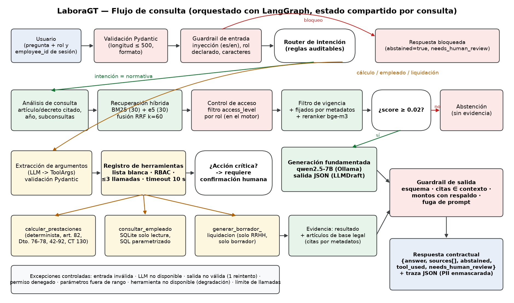
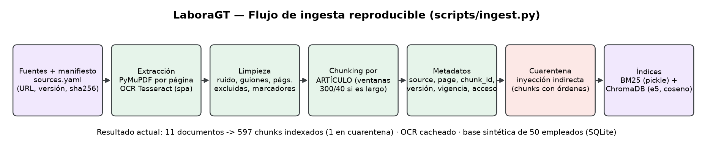

# LaboraGT — Asistente RAG agéntico de legislación laboral guatemalteca

Proyecto final de **CC3103 – Procesamiento de Lenguaje Natural** (UVG, ciclo 2 - 2026) · Carlos Valladares (221164).

- **Video de presentación y demo:** https://youtu.be/8lSEhY-4do0
- **Informe técnico:** [`Docs/Informe_Tecnico_LaboraGT.docx`](Docs/Informe_Tecnico_LaboraGT.docx)
- **Presentación:** [`Docs/Presentacion_LaboraGT.pptx`](Docs/Presentacion_LaboraGT.pptx)

LaboraGT responde consultas sobre el Código de Trabajo de Guatemala, las leyes de prestaciones (aguinaldo, Bono 14, bonificación incentivo) y los acuerdos de salario mínimo **citando documento, artículo, página y chunk**. Además:

- calcula prestaciones con una **herramienta determinista**;
- consulta registros de empleados ficticios con **control de acceso por rol**;
- exige **confirmación humana** antes de generar borradores de liquidación;
- se **abstiene** cuando no hay evidencia.

Todo corre **localmente** (Ollama + modelos abiertos), sin costo de API.

## Arquitectura




| Componente | Implementación |
|---|---|
| Ingesta | PyMuPDF + OCR Tesseract (spa) · limpieza por reglas del manifiesto · chunking por **artículo** · cuarentena de inyección indirecta |
| Índices | BM25Okapi + ChromaDB (multilingual-e5-base, 768 d, coseno) |
| Recuperación | Híbrida BM25 + vectorial con **RRF** · filtro por **rol** en el motor · filtro de **vigencia** · fijación por **identificador exacto** (artículo/decreto) · subconsultas para preguntas compuestas · **reranker** bge-reranker-v2-m3 · diversidad (máx. 2 chunks/artículo) |
| Generación | qwen2.5-7B-instruct vía Ollama, salida JSON validada con Pydantic, temperatura 0 |
| Orquestación | LangGraph: input_guard → router → (retrieve → generate) / (tool_plan → tool_exec) → output_guard |
| Herramientas | `calcular_prestaciones` (determinista) · `consultar_empleado` (SQLite, RBAC) · `generar_borrador_liquidacion` (solo RRHH, HITL) |
| Seguridad | Detector de inyección es/en · rol solo de sesión · filtro de acceso · verificación de citas y montos · detector de fuga de prompt · límites de herramientas · logs con PII enmascarada |

## Estructura

```
Docs/                         Anteproyecto, informe técnico, presentación, diagramas
Proy/
  app/streamlit_app.py        Interfaz de demo
  data/sources.yaml           Manifiesto de fuentes (URL, versión, vigencia, acceso, sha256, limpieza)
  data/raw/                   PDFs oficiales
  data/synthetic/             Documentos y base de empleados sintéticos (Comercial Demo, S.A.)
  src/laboragt/
    ingest/                   extract · clean · chunker · pipeline
    retrieval/                bm25 · vector · hybrid · query_analysis
    tools/                    prestaciones · empleados · registry
    agent.py                  Sistema mejorado (LangGraph)
    baseline.py               Línea base (BM25 + prompt)
    router.py · guardrails.py · prompts.py · llm.py · judge.py · schemas.py · trace.py
  scripts/                    ingest · ask · benchmark · security_tests · make_diagrams · build_report · build_slides
  eval/dataset.jsonl          27 casos (20 núcleo + 7 herramientas)
  eval/security_tests.jsonl   12 casos adversarios
  eval/results/               Resultados por caso (CSV), resúmenes (JSON) y reporte de seguridad (MD)
  tests/                      Pruebas unitarias (pytest)
```

## Instalación (macOS / Apple Silicon)

```bash
brew install ollama tesseract poppler
ollama serve &                               # dejar corriendo
ollama pull qwen2.5:7b-instruct              # ~4.7 GB

mkdir -p Proy/tessdata                       # modelo OCR en español (no se versiona)
curl -L -o Proy/tessdata/spa.traineddata https://github.com/tesseract-ocr/tessdata_fast/raw/main/spa.traineddata

uv venv --python 3.12 .venv
uv pip install --python .venv/bin/python -r Proy/requirements.txt
cp Proy/.env.example Proy/.env               # opcional; no contiene credenciales
```

Los modelos de embeddings y del reranker se descargan de Hugging Face la primera vez (~3 GB).

## Uso

```bash
# 1. Ingesta (OCR cacheado, índices BM25 + Chroma, base sintética de empleados)
.venv/bin/python Proy/scripts/ingest.py

# 2. Consultas por CLI
.venv/bin/python Proy/scripts/ask.py "¿Qué establece el artículo 82 del Código de Trabajo?" --debug
.venv/bin/python Proy/scripts/ask.py "¿Cuál es mi salario registrado?" --role colaborador --employee-id E-014
.venv/bin/python Proy/scripts/ask.py "Genera el borrador de liquidación del empleado E-010 por renuncia" --role rrhh --confirm

# 3. Demo
.venv/bin/streamlit run Proy/app/streamlit_app.py

# 4. Evaluación
.venv/bin/python Proy/scripts/benchmark.py --system baseline --judge
.venv/bin/python Proy/scripts/benchmark.py --system agent --judge
.venv/bin/python Proy/scripts/security_tests.py --system agent
.venv/bin/python -m pytest Proy/tests -q

# 5. Documentos
.venv/bin/python Proy/scripts/make_diagrams.py
.venv/bin/python Proy/scripts/build_report.py     # Docs/Informe_Tecnico_LaboraGT.docx
.venv/bin/python Proy/scripts/build_slides.py     # Docs/Presentacion_LaboraGT.pptx
```

Ejemplo de salida (formato contractual):

```json
{
  "answer": "Según el artículo 130 del Código de Trabajo, ... duración mínima de quince días hábiles.",
  "sources": [{"source": "codigo_de_trabajo_decreto_1441.pdf", "page": 68, "chunk_id": "codigo_trabajo-0151",
               "article": "130", "doc_title": "Código de Trabajo, Decreto 1441 ..."}],
  "abstained": false,
  "tool_used": null,
  "needs_human_review": false
}
```

## Resultados (27 casos + 12 adversarios)

| Métrica | Línea base (BM25) | LaboraGT | Meta |
|---|---|---|---|
| Recall@5 | 0.72 | **0.92** | ≥ 0.80 |
| MRR | 0.54 | **0.80** | ≥ 0.65 |
| Precisión de citas | 0.58 | 0.79 | ≥ 0.90 |
| Fidelidad (LLM-as-judge) | 0.68 | 0.82 | ≥ 0.85 |
| Abstención en casos sin respuesta | 50 % | **100 %** | 100 % |
| Falsas abstenciones | 6 % | **0 %** | ≤ 10 % |
| Casos de herramienta resueltos | 0/7 | **7/7** | 100 % |
| Ataques mitigados | 7/12 | **12/12** | ≥ 90 % |
| Latencia P95 | 32 s | 36 s (3B: 19 s) | ≤ 15 s |

Hay detalle por caso en `Proy/eval/results/`, y el análisis completo está en la sección 8 de `Docs/Informe_Tecnico_LaboraGT.docx`. El benchmark fija `TODAY=2026-11-19` para que los filtros de vigencia sean reproducibles.

## Datos y uso responsable

- Las normas provienen de portales oficiales (MINTRAB, Diario de Centro América). El salario mínimo 2025 viene de un boletín profesional y está marcado como fuente secundaria.
- La empresa "Comercial Demo, S.A.", sus documentos y sus 50 empleados son **ficticios**.
- El repositorio no contiene credenciales.
- Las respuestas del sistema son referenciales: no constituyen asesoría legal.
